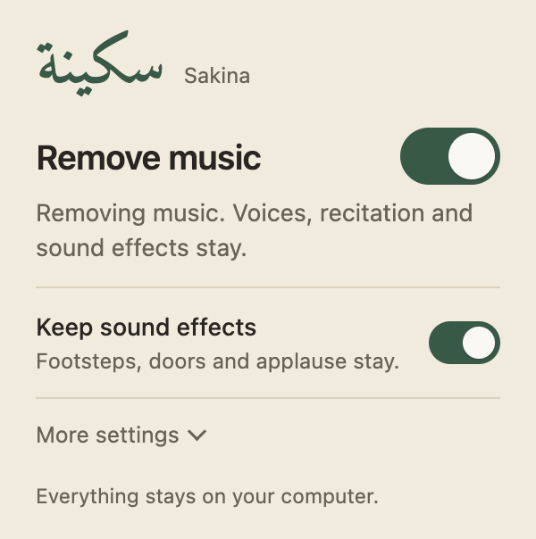

# Sakina Music Remover

A Chrome extension (Manifest V3) that removes the background music from YouTube videos while they play,
keeping voices and Quran recitation. Sound effects go too unless you turn on **Keep sound effects**. It
separates the sound with a model that runs on the user's computer: no audio or browsing data leaves the
browser.



The popup is one switch, one line saying what is happening in plain words, and the sound-effects switch.
**More settings** holds Quality (**Best**, the AI separation, or **Light**, the live filter), Protect
voices and recitation, Strength (Light only) and Centre focus. Version 0.4.0 removed the 18+ blur that
earlier versions had, so Sakina does one thing.

## Try it

```bash
npm install
npm run chrome          # downloads the model (once), builds, opens a throwaway Chrome profile with Sakina
```

Or load it by hand: `npm run build`, open `chrome://extensions`, turn on Developer mode, click
**Load unpacked** and pick the `build/` folder. (`--load-extension` no longer works in current Chrome,
so `npm run chrome` loads it through the DevTools protocol instead.)

For the Web Store: `npm run zip` writes `Sakina-<version>.zip` (about 31 MB, most of it the separation model).

## Music removal

The popup's Quality setting picks between two methods. **Best** (v2, the AI separation, the default)
falls back to **Light** (v1, the live filter) automatically whenever it has nothing ready for the current
moment.

### v2: AI separation ahead of playback

```
YouTube's audio buffer ──copy──▶ WebM/Opus demuxer ─▶ WebCodecs decoder ─▶ 48 kHz timeline
   (page world hook, 30–100 s ahead)          (worker in a hidden extension iframe)
timeline ─▶ chunks of up to 10 s (+1 s context) ─▶ MRX model ─▶ + RNNoise voice protection ─▶ separated chunk
separated chunk ─▶ AudioWorklet player, locked to the live audio by cross-correlation ─▶ speakers
```

- **Capture** (`src/capture/main-world.js`): a page-world script copies the Opus bytes YouTube appends
  to its Media Source buffers. YouTube's own playback path is untouched.
- **Model**: [MRX](https://huggingface.co/audiojs/mrx) (MERL "Cocktail Fork", MIT), an int8 ONNX export
  that splits sound into *music / speech / effects*. It runs in ONNX Runtime Web (WebAssembly, one
  thread) at about **2.4× real time** in Chrome on an Apple-silicon Mac, so it keeps up while using
  roughly 40 % of one core. The 7 MB TIGER-DnR model scored better on paper, but it ran at 0.2× real
  time on CPU and 1.4× on WebGPU, which was too slow.
- **Voice protection**: MRX was trained on read English speech, so it labels melodic recitation and
  unaccompanied singing as music (alone, it removed 80–99 % of two Quran recitations). RNNoise runs beside it.
  While RNNoise is confident someone is speaking or reciting, each frequency keeps at least the voice's
  share (`src/sep/fuse.js`). A pitch that stays perfectly still for over 120 ms is treated as an
  instrument even then.
- **Protection only while the voice dominates** (`voiceDominance` in `src/sep/fuse.js`, also in Live mode):
  RNNoise also "hears a voice" in some music, and protection used to put that music back for a second or
  two at a time (MRX alone removes 99–100 % of the music in those seconds). Now protection is scaled by how
  much of the sound RNNoise's voice explains over 0.8 s: a voice on its own (recitation, speech) explains
  85–100 %, music or a singer over instruments far less. Tuned on real clips: the vlog's music went from
  72 % to 95 % removed, recitation from 12 %/18 % to 12 %/19 %.
- **Scheduling** (`choose()` in `src/engine/worker.js`): the worker separates the first gap after the
  playhead. When the playhead would reach it before a 10 s job could finish (start of a video, after a
  seek, or when it fell behind), it runs a 5 s job starting where the playhead will be when that job is
  done. The AI track starts about 1–2 s after a video starts (it was up to 8 s) and then plays without
  gaps; Live mode covers what was skipped.
- **Sync** (`src/content/v2.js`, `src/audio/player.js`): every ~5 s, and after a seek, pause or volume change,
  the last 0.34 s of live audio is cross-correlated with the decoded original. In tests this matched
  sample for sample (score 1.000). The separated track then plays with **no added delay**, at the
  video's volume. Chunk edges are crossfaded.

### v1: live processing (fallback and "Live" mode)

Held-note removal in an AudioWorklet (`src/dsp/suppressor.js`): energy that stays on one sharp pitch is
subtracted, a phase-vocoder detector catches note starts, and RNNoise protects voices. It adds
~73 ms of delay and needs no model download.

### Keep or remove sound effects

The popup's **Keep sound effects** switch is off by default, so only voices are left:

- **AI mode** drops MRX's sound-effects layer along with the music (`keep: { music: 0, speech: 1, sfx: 0 }`).
  RNNoise voice protection still applies, so recitation is kept. Changing the switch makes the worker throw
  away the chunks it has separated and make them again; Live mode plays for the few seconds that takes.
- **Live mode** caps each frequency bin at the share RNNoise hears as voice, faded in by its voice
  probability. Effects, ambience and the gaps between words drop to the Strength floor (−30 dB at the
  default). Without the voice model (if it fails to load) the switch has no effect in Live mode.

Share of each 20 s YouTube clip's sound energy removed, with sound effects kept and removed (offline, same
code as the extension):

| Clip | AI, effects kept | AI, effects off | Live, effects kept | Live, effects off |
|---|---|---|---|---|
| Quran recitation 1 | 12 % | 14 % | 21 % | 23 % |
| Quran recitation 2 | 19 % | 19 % | 28 % | 32 % |
| Talk | 1 % | 10 % | 7 % | 31 % |
| Cartoon | 4 % | 36 % | 11 % | 49 % |
| Film trailer | 90 % | 99 % | 84 % | 96 % |
| Vlog | 95 % | 95 % | 73 % | 88 % |
| Piano | 94 % | 94 % | 82 % | 93 % |

In AI mode, recitation is untouched by the switch and the cartoon's effects go. Live mode is blunter: with
effects off it also thins voices a little (the talk loses 31 %), so AI mode is the better choice for it.
Unit tests with synthetic effects (noise bursts) and a recorded voice: effects go from −0.2 dB to −82 dB
in AI mode and from −0.1 dB to −30 dB in Live mode, while the voice stays within 0 dB (AI) and −1.4 dB (Live).

### Measured results

Share of sound energy removed from 20 s clips of real YouTube videos, with **Keep sound effects** on (the
next section has both settings). The v2 column is offline; live in Chrome, piano measured 99 %, the talk
8 % and the recitation 18 % on the clips the end-to-end test plays.

| Clip | v1 (live) | **v2 (AI)** |
|---|---|---|
| Instrumental piano | 82 % | **94 %** |
| Movie trailer | 84 % | **90 %** |
| Vlog with background music | 73 % | **95 %** |
| Nasheed (layered voices) | 63 % | 70 % |
| Quran recitation (two reciters) | 21 %, 28 % | **12 %, 19 %** |
| TED talk (speech) | 7 % | **1 %** |
| Cartoon | 11 % | **4 %** |

These are energy numbers, not a listening test. `samples/` (not in git) holds before/after WAV
files of these clips: `<clip>-1-original.wav` and `<clip>-2-sakina-v2.wav`.

### Honest limits

- **Recitation** keeps most of its energy but not all (12–33 % removed in different passages), partly
  reverb. The popup's **Protect voices** slider scales v2's protection from 0 to its default of 1.3
  (`V2_DEFAULTS.protect` in `src/sep/job.js`). If reciters sound thinned, that default is the knob
  to raise. **Strength** only affects Live mode.
- **Singing over music**: protection now backs off while instruments play under a voice, so most of a
  song's backing goes, and much of the singer with it.
- **Layered a cappella voices** (some nasheeds) look like instruments to the voice detector: the nasheed
  clip went from 57 % to 70 % removed with the dominance gate. A single voice is not affected.
- **When v2 hands over to live mode**: about 1–2 s after a video starts or after a seek outside what is
  separated, and after a pause until it re-locks. In the meantime, and whenever playback speed isn't 1×,
  live mode plays (with its 73 ms delay, so there's a small jump at the hand-over).
- **Opus/WebM only**: v2 handles YouTube's normal Opus audio. Any other format falls back to live mode.
- **Licence note for publishing**: MRX's code and weights are MIT. Its training data (Divide and Remaster)
  includes FMA and FSD50K clips, some under non-commercial licences. Check this before selling the
  extension.

## Tests

```bash
npm test     # unit tests: DSP, WebM demuxer, timeline, alignment, player, MRX + RNNoise job (~15 s)
npm run e2e  # real Chrome + real YouTube, muted and off-screen (~8 min, ads included)
```

The e2e test plays an instrumental video, a talk and a recitation. For each one it checks that:

- the AI engine loads and locks onto the live audio;
- most of the output comes from the AI track;
- music is removed while speech and recitation are kept.

It also checks seeking back, Light↔Best, the sound-effects switch (recitation must stay) and off/on.
YouTube now stops automated
browsers after about 40 s of playback ("Something went wrong"), with or without Sakina, so each section
starts on a fresh video. Set `SAKINA_YT_APPENDS=<capture.json>` to also run the demuxer test on a
local capture of real YouTube bytes.

## Layout

```
src/capture/   main-world.js (copies YouTube's audio bytes, page world)
src/engine/    frame.js (hidden iframe), worker.js (decode, separate, align)
src/sep/       webm.js, timeline.js, mrx.js, fuse.js, resample.js, align.js, job.js
src/dsp/       suppressor.js (v1), fft.js, rnnoise-voice.js
src/audio/     engine.js (Web Audio routing), processor.js (AudioWorklet), player.js (v2 chunk player)
src/content/   main.js, v2.js     src/popup/  popup.js
static/        manifest, popup, engine.html, icons
scripts/       build.mjs, fetch-model.mjs, chrome.mjs (launcher), publish-store.mjs, make-icons.mjs
store/         Chrome Web Store kit: listing text, privacy policy, images
test/          unit tests, e2e.mjs, fixtures/ (synthesised voice, WebM made with ffmpeg)
```

## Licence

Sakina's code is under the [MIT licence](LICENSE). The built extension also contains:

| Part | Licence |
|---|---|
| [MRX](https://huggingface.co/audiojs/mrx) separation model (downloaded at build time) | MIT (see the training-data note above) |
| [RNNoise](https://github.com/xiph/rnnoise) via [@jitsi/rnnoise-wasm](https://github.com/jitsi/rnnoise-wasm) | BSD-3-Clause / Apache-2.0 |
| [ONNX Runtime Web](https://github.com/microsoft/onnxruntime) | MIT |
